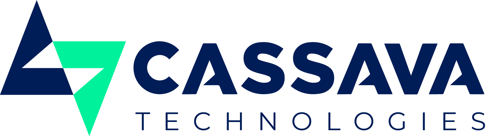

<!-- Replace your-org/aiops-platform with the real GitHub slug once the repo is pushed. -->
<p align="center">
  <picture>
    <source media="(prefers-color-scheme: dark)" srcset="brand/logo/cassava-logo-white.png">
    
  </picture>
</p>

<h1 align="center">Predictive AIOps platform</h1>
<p align="center">Predict infrastructure and application failures 5–15 minutes ahead, explain them with evidence, and open the ticket before anyone is paged.</p>

<p align="center">
  <a href="https://github.com/your-org/aiops-platform/actions/workflows/ci.yml"></a>
  
  
  
  
  
  
</p>
<p align="center">
  
  
  
  
  
  
  
  <a href="https://www.conventionalcommits.org"></a>
  <a href="LICENSE"></a>
</p>

Collects metrics, logs and traces; **predicts failures 5–15 minutes ahead**; investigates
candidates with an LLM agent; opens a ServiceNow ticket (or Teams/Slack/e-mail) with root cause,
evidence and the recommended fix. Self-hostable, multi-tenant, data-residency-safe.

> Cheap detectors watch everything; the LLM investigates only candidate incidents.

## Quick start

```bash
cp .env.example .env        # set tenant, credentials and an LLM: hosted key, vLLM (GPU) or the default Ollama
make up                     # core + observability (+ ai) profiles, waits for healthy
make test                   # lint, mypy --strict, unit + e2e (coverage ≥ 80 %), evals, contracts
```

Plug in your LLM by setting `AIOPS_LLM__BASE_URL`, `AIOPS_LLM__MODEL` and `AIOPS_LLM__API_KEY`
(any OpenAI-compatible endpoint), or `AIOPS_LLM__PROVIDER=holmes` for HolmesGPT.

## Operator console

Served by the control plane at **`/console`** (`http://localhost:8084/console/` in dev). Incidents are
ordered by time left before failure; the bar runs from the first warning to the predicted failure,
marked with the Cassava triangle. Operators label outcomes and request fixes; a second person
approves; every action lands in the audit log. Sign-in uses OIDC (authorization code + PKCE) when
`AIOPS_CONSOLE_OIDC_ISSUER`/`AIOPS_CONSOLE_OIDC_CLIENT_ID` are set, or a pasted token in dev (`make token`).

Brand: Cassava theme colours and fonts (Montserrat, Arial) from [`brand/`](brand/README.md), shared by the
console and Grafana dashboards.

## Layout

| Path | What |
|---|---|
| `libs/aiops-common` | contracts (Pydantic → JSON Schema), CloudEvents, Kafka bus + DLQ, retry/circuit breaker, JSON logging, OTel, PII redaction, routing rules |
| `services/*` | ingest-gateway, detector-workers, correlator, agent-gateway, router, feedback-service, control-plane-api, chaos-sim, mock-servicenow |
| `contracts/` | JSON Schemas (v1), `asyncapi.yaml`, OpenAPI 3.1 per HTTP service — generated, CI-checked |
| `config/` | OTel Collector, Alloy, vmalert `predict_linear` rules, Grafana dashboards, runbooks, Keep workflow, router channels, remediation playbooks |
| `deploy/compose` · `deploy/docker` · `deploy/helm` · `deploy/argocd` | dev stack · image · charts · GitOps |
| `evals/` | recorded incidents + harness (replay in CI, live with your LLM) |
| `tests/e2e` · `tests/integration` | in-process chaos → ticket pipeline · Testcontainers Kafka/Postgres |
| `docs/` | `architecture.md`, `adr/`, `runbooks/` |
| `ui/console` · `brand/` | operator console (static, served by control-plane-api) · Cassava brand kit |

## Milestone status

| Milestone | Status |
|---|---|
| M0 Foundations | ✅ done — CI pipeline defined; contracts validated in tests |
| M1 Observe | ✅ built — Compose stack, dashboards, `predict_linear` rules, chaos scenarios. The "`make up` in < 5 min" check has not been run (see below) |
| M2 Detect | ✅ e2e-proven: one candidate per scenario, duplicate suppression |
| M3 Investigate | ✅ agent gateway, 8 runbooks, evals 10/10 (replay); live evals need your key |
| M4 Act | ✅ outbox, ServiceNow EM + Table, Keep, chat, e-mail, Clear; no duplicates under replay/outage |
| M5 Learn | ✅ feedback KPIs, tuning proposals, four-eyes remediation with audit |
| M6 Production | 🟡 scaffolding only: Helm service + umbrella charts (PDB, NetworkPolicy, KEDA, ESO, ServiceMonitor), Argo CD app-of-apps. Data-plane apps, backups and load/failover tests remain |

See `docs/architecture.md` → *Verified vs unverified third-party APIs* before going live.
